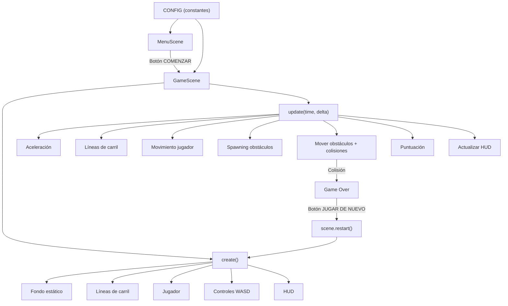

# 🏎️ Carreras Arcade — Proyecto Completo

## 1. Descripción del juego

Juego de carreras arcade 2D con vista superior (*top-down*) desarrollado con Phaser 3.60.0. El jugador controla un automóvil que avanza por una carretera de 4 carriles y debe esquivar vehículos que aparecen como obstáculos. La velocidad aumenta progresivamente, incrementando la dificultad. La partida termina al colisionar con un obstáculo.

Todos los gráficos se generan mediante las herramientas de dibujo de Phaser 3 — no se usan imágenes externas.

---

## 2. Plan de implementación

### Arquitectura

El juego usa **2 escenas de Phaser**:

| Escena | Responsabilidad |
|--------|----------------|
| `MenuScene` | Pantalla inicial con título, instrucciones y botón COMENZAR |
| `GameScene` | Partida completa: carretera, jugador, obstáculos, HUD, game over y reinicio |

### Enfoque técnico

| Aspecto | Solución |
|---------|----------|
| **Controles** | `this.input.keyboard.addKeys()` con teclas WASD. Normalización diagonal con factor `1/√2` |
| **Carretera** | Fondo estático (hierba + asfalto) + líneas de carril redibujadas cada frame con offset creciente |
| **Obstáculos** | Sprites generados con texturas dinámicas. Acumulador de tiempo para spawning progresivo |
| **Colisiones** | Detección AABB manual con margen de tolerancia para que se sienta justa |
| **Puntuación** | Acumulador basado en `deltaTime` × puntos/segundo. Texto actualizado sin recrear objetos |
| **Velocidad** | Aceleración lineal constante desde 200 hasta un máximo de 600 |
| **Game Over** | Container de Phaser con overlay, panel, puntuación y botón. `scene.restart()` para reinicio limpio |
| **Adaptación** | `Phaser.Scale.FIT` + `CENTER_BOTH` |

---

## 3. Estructura de archivos

```
carreras-phaser/
├── index.html          ← Carga Phaser 3 (CDN), CSS y JS
├── css/
│   └── style.css       ← Centra el canvas, fondo oscuro con sombra neón
├── js/
│   └── game.js         ← Toda la lógica: CONFIG, MenuScene, GameScene, phaserConfig
├── README.md           ← Documentación completa
└── .gitignore          ← Excluye temporales, node_modules, .vscode
```

---

## 4. Archivos del proyecto

> [!NOTE]
> Todos los archivos ya han sido creados en `c:\Users\WebAvanzadas\Desktop\carreras-phaser\`.

| Archivo | Ruta | Tamaño |
|---------|------|--------|
| [index.html](file:///c:/Users/WebAvanzadas/Desktop/carreras-phaser/index.html) | Raíz | 572 B |
| [style.css](file:///c:/Users/WebAvanzadas/Desktop/carreras-phaser/css/style.css) | css/ | 904 B |
| [game.js](file:///c:/Users/WebAvanzadas/Desktop/carreras-phaser/js/game.js) | js/ | ~28 KB |
| [README.md](file:///c:/Users/WebAvanzadas/Desktop/carreras-phaser/README.md) | Raíz | ~5 KB |
| [.gitignore](file:///c:/Users/WebAvanzadas/Desktop/carreras-phaser/.gitignore) | Raíz | 199 B |

### Resumen de `game.js`



---

## 5. Instrucciones de ejecución local

### Opción A — Live Server en VS Code (recomendada)

1. Abre VS Code y ve a **Archivo → Abrir carpeta** → selecciona `carreras-phaser`.
2. Instala la extensión **Live Server** (de Ritwick Dey) si no la tienes:
   - `Ctrl+Shift+X` → busca "Live Server" → **Instalar**.
3. En el explorador de archivos de VS Code, haz clic derecho en `index.html` → **"Open with Live Server"**.
4. El juego se abrirá automáticamente en tu navegador (la dirección típica es `http://127.0.0.1:5500`; el puerto puede variar).

### Opción B — Python

```bash
cd c:\Users\WebAvanzadas\Desktop\carreras-phaser
python -m http.server 8080
```
Luego abre `http://localhost:8080` en el navegador.

> [!WARNING]
> No abras `index.html` directamente con `file://`. Phaser necesita un servidor HTTP para cargar correctamente.

---

## 6. Lista de pruebas funcionales

| # | Comprobación | Estado |
|---|-------------|--------|
| 1 | La pantalla inicial se muestra con título, instrucciones y botón | ☐ |
| 2 | El botón COMENZAR inicia la partida | ☐ |
| 3 | Las teclas WASD mueven el automóvil en las 4 direcciones | ☐ |
| 4 | El automóvil no sale de los límites de la carretera | ☐ |
| 5 | La carretera (líneas de carril) se desplaza continuamente | ☐ |
| 6 | Los obstáculos aparecen desde arriba y bajan por la carretera | ☐ |
| 7 | Las colisiones se detectan correctamente | ☐ |
| 8 | La partida se detiene tras una colisión y se muestra Game Over | ☐ |
| 9 | La puntuación (PTS) aumenta durante la partida | ☐ |
| 10 | El indicador de velocidad (VEL) se actualiza progresivamente | ☐ |
| 11 | El botón JUGAR DE NUEVO reinicia la partida correctamente | ☐ |
| 12 | No aparecen errores en la consola del navegador (F12) | ☐ |
| 13 | Tras reiniciar, la puntuación vuelve a 0 y los obstáculos se limpian | ☐ |
| 14 | El movimiento diagonal no es más rápido que el horizontal/vertical | ☐ |

---

## 7. Creación del repositorio y comandos Git

### 7.1 Crear el repositorio en GitHub

1. Ve a [github.com/new](https://github.com/new).
2. **Repository name**: `carreras-phaser`
3. **Visibility**: Public
4. **No** marques "Add a README file" ni "Add .gitignore" (ya los tienes).
5. Clic en **Create repository**.

### 7.2 Subir el proyecto desde VS Code

Abre la terminal integrada de VS Code (`Ctrl+Ñ` o `` Ctrl+` ``) y ejecuta estos comandos uno por uno:

```bash
# 1. Inicializar el repositorio Git local
git init
```

```bash
# 2. Añadir todos los archivos al área de preparación (staging)
git add .
```

```bash
# 3. Crear el primer commit con un mensaje descriptivo
git commit -m "feat: juego de carreras arcade con Phaser 3"
```

```bash
# 4. Renombrar la rama principal a "main"
git branch -M main
```

```bash
# 5. Vincular el repositorio remoto
#    ⚠️ Sustituye TU_USUARIO por tu nombre de usuario real de GitHub
git remote add origin https://github.com/TU_USUARIO/carreras-phaser.git
```

```bash
# 6. Subir los archivos al repositorio remoto
git push -u origin main
```

> [!IMPORTANT]
> Sustituye `TU_USUARIO` en el paso 5 por tu nombre de usuario real de GitHub. Si usas HTTPS, GitHub te pedirá autenticación (puedes configurar un token de acceso personal o usar GitHub CLI).

---

## 8. Configuración de GitHub Pages

1. Ve a tu repositorio en GitHub: `https://github.com/TU_USUARIO/carreras-phaser`
2. Haz clic en **Settings** (pestaña superior).
3. En el menú lateral, haz clic en **Pages**.
4. En la sección **Build and deployment**:
   - **Source**: selecciona **Deploy from a branch**.
   - **Branch**: selecciona `main` y carpeta `/ (root)`.
5. Haz clic en **Save**.
6. Espera 1-3 minutos. Recarga la página de Settings → Pages.
7. Aparecerá un mensaje con la URL pública:
   **`https://TU_USUARIO.github.io/carreras-phaser/`**

> [!TIP]
> Si el juego no carga inmediatamente, espera unos minutos y recarga. GitHub Pages puede tardar hasta 10 minutos en la primera publicación.

---

## 9. Verificación de la publicación

Abre la URL pública (`https://TU_USUARIO.github.io/carreras-phaser/`) y comprueba:

| Verificación | Estado |
|-------------|--------|
| La página carga sin errores 404 | ☐ |
| El canvas de Phaser se muestra correctamente | ☐ |
| La pantalla inicial aparece con título e instrucciones | ☐ |
| El botón COMENZAR inicia la partida | ☐ |
| Los controles WASD funcionan | ☐ |
| Los obstáculos aparecen y bajan | ☐ |
| Las colisiones se detectan | ☐ |
| La puntuación se actualiza | ☐ |
| El reinicio funciona correctamente | ☐ |
| La consola del navegador (F12) no muestra errores de carga | ☐ |

---

## 10. Problemas frecuentes y soluciones

| Problema | Causa probable | Solución |
|----------|---------------|----------|
| Página en blanco | Phaser no se cargó desde el CDN | Abre la consola (F12) y verifica si hay un error de red. Comprueba conexión a internet |
| Error `404` en `js/game.js` o `css/style.css` | Las rutas son relativas y el archivo no existe en la ubicación esperada | Verifica que la estructura de carpetas sea correcta y que los nombres coincidan |
| El juego no arranca al abrir `index.html` directamente | `file://` no permite cargar scripts de CDN en algunos navegadores | Usa un servidor HTTP local (Live Server o Python) |
| Los controles WASD no responden | El foco no está en el canvas del juego | Haz clic dentro del área del juego antes de usar las teclas |
| La puntuación sigue subiendo tras Game Over | Bug en el flujo de `isGameOver` | Verifica que `update()` retorne inmediatamente cuando `isGameOver === true` (ya implementado) |
| Al reiniciar se acumulan obstáculos o eventos | La escena no se limpió correctamente | Se usa `scene.restart()` que limpia todo automáticamente |
| En GitHub Pages aparece error 404 | GitHub Pages no está configurado o el despliegue aún no terminó | Espera unos minutos. Verifica en Settings → Pages que la rama y carpeta sean correctas |
| El juego se ve muy pequeño o muy grande | La escala no se ajustó | `Phaser.Scale.FIT` está configurado. Ajusta el tamaño de la ventana del navegador |
